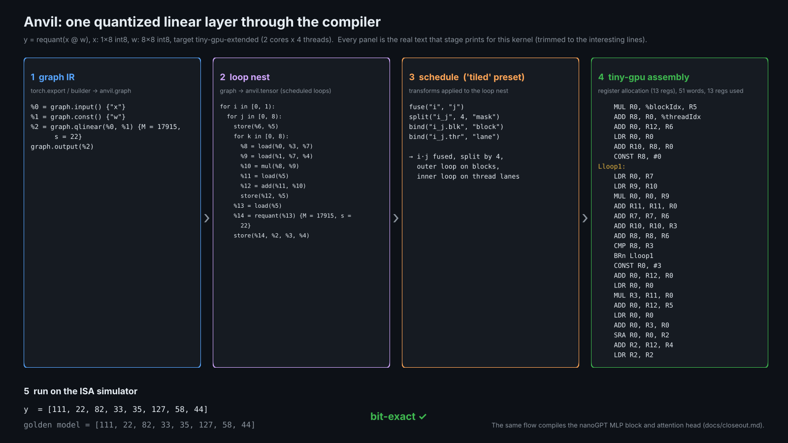
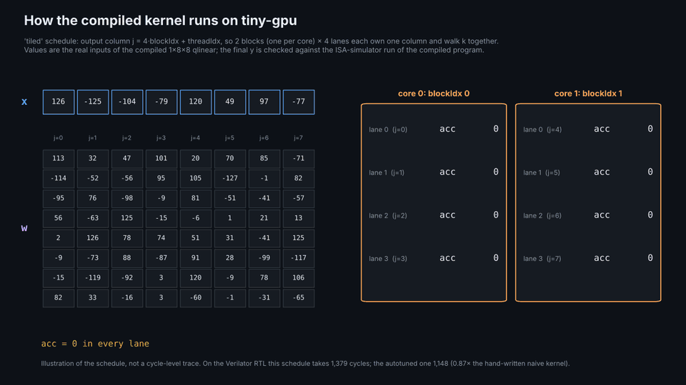
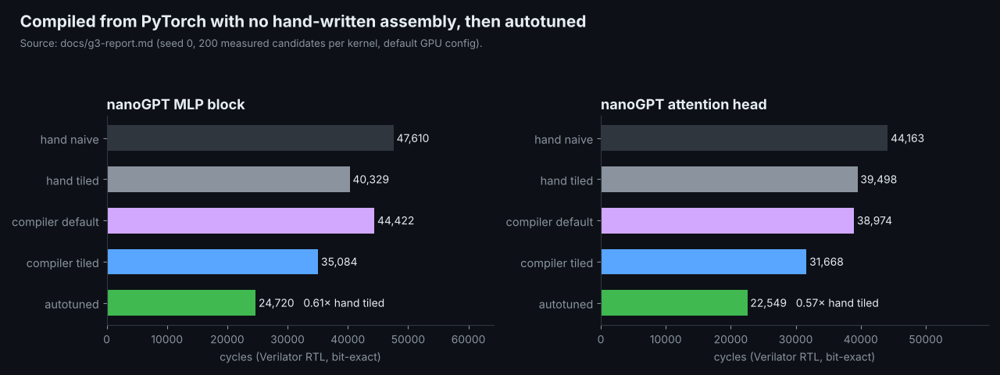
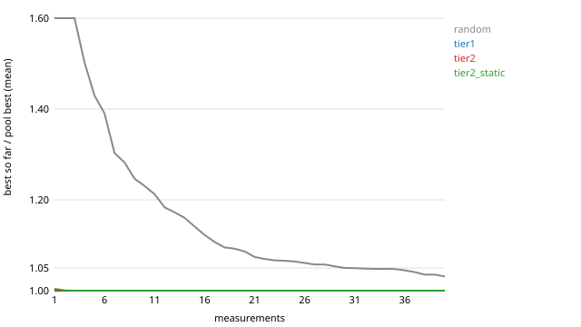
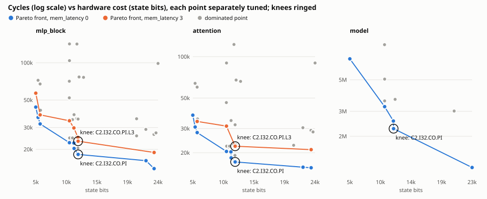

# Anvil

A tensor compiler that lowers PyTorch transformer blocks (nanoGPT Extended) onto the tiny-gpu-extended ISA.
See `docs/design.md` for the design and `PLAN.md` for status.

## Gallery



*One `qlinear` (1×8×8) through Anvil: graph IR, scheduled loop nest, the `tiled` schedule's transforms, and the register-allocated tiny-gpu assembly. Every panel is the text that stage actually prints for this kernel. The ISA-simulator result is bit-exact with the golden model.*



*How that schedule maps onto tiny-gpu: 2 blocks (one per core) × 4 lanes, one output column per lane. This is an illustration of the schedule, not a cycle-level trace. It uses the kernel's real inputs, and the script asserts the final `y` equals the ISA-simulator run. [MP4](docs/media/execute.mp4)*



*G3: the nanoGPT MLP block and attention head compiled from PyTorch, against the hand-written xf kernels. Cycles come from the Verilator RTL, all bit-exact (`docs/g3-report.md`).*

| Cost-model-guided tuning (G4) | Hardware/software co-design sweep (G5) |
|---|---|
|  |  |

Regenerate the media with `PYTHONPATH=sim:. python3 tools/media.py`.

## Install

The simulator is a pinned submodule; Anvil imports its `xf` package from `sim/`, so put `sim` on `PYTHONPATH`
(the tests do this themselves through `tests/conftest.py`).

```bash
git submodule update --init                                  # sim/ (tiny-gpu-extended) + vortexv/ (Vortex-V), read-only
pip install numpy xdsl==0.75.0 pytest hypothesis             # core + tests
pip install torch cocotb==2.0.1 lightgbm                     # torch frontend, RTL runs, cost models (optional)
apt-get install -y iverilog verilator                        # plus sv2v 0.0.13: see PLAN.md "Environment"
export PYTHONPATH=sim:.
```

The torch tests and the model scripts also need nanoGPT Extended at 03dbab8 in `NANOGPT_DIR` (PLAN.md).

## Use

```python
import anvil
from anvil.runtime import GpuParams

cm = anvil.compile(block, (x_example,), calib_inputs, GpuParams(), schedules="tiled")   # torch.nn.Module
cm = anvil.compile((graph_module, consts))                                               # or anvil.graph IR
res = cm.run(x, "isasim")          # "isasim" | "verilator" | "rtl"; quantized=True takes int8 inputs
res.output, res.ints, res.cycles, res.stray_writes()
print(cm.summary())                # per-kernel schedule, program words, launches, memory plan
```

`schedules` is `"default"`, `"tiled"`, `"tuned"` (anvil.tune), a dict per kernel or op, or a callable; see the
`anvil.driver` docstring. `anvil.runtime.check_races(job)` checks a job for cross-block read/write races.

## Second target: Vortex-V (RISC-V + Xmlacc)

`anvil.vortexv` lowers the same graph IR to one RV64IM + Xmlacc program for
[Vortex-V](https://github.com/Ashtonantony28/vortex-v) (pinned submodule `vortexv/`). Every graph op is supported,
and results are bit-exact to the interpreter on Vortex-V's ISS and in lockstep on its RTL cores. This includes the
2-layer model. Design, checks and cycle counts are in `docs/vortexv-backend.md`.

```python
from anvil import vortexv
res = vortexv.compile(module, consts).run({"x": x})       # res.outputs, res.values, res.instret
```

## Test

```bash
make check                                                   # unit + isasim levels, no RTL, no torch (< 5 min)
python3 -m pytest -q -m rtl tests/codegen tests/tune tests/cost tests/audit
NANOGPT_DIR=... python3 -m pytest -q -m "(rtl or torch) and not slow" tests/driver tests/tune
```

Reports: `docs/codegen-bench.md`, `docs/g1-report.md` .. `docs/g5-report.md`, the close-out summary `docs/closeout.md`, each with the command that
regenerates it.
