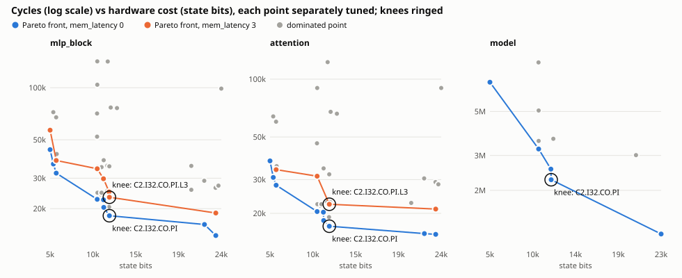

# G5 report: hardware/software co-design

Generated by `PYTHONPATH=sim python3 -m anvil.codesign.report` from cached results only; do not edit. Sources: the co-design sweep's point records `data/codesign/sweep/<workload>/<config>.json` (`python3 -m anvil.codesign.sweep`) and the ISA study's records `data/codesign/isa/<variant>/<workload>.json` (`python3 -m anvil.isa_ext.study`). Every number below is a field of the record named in its row.

## Method

* **Configurations** (`anvil.codesign.space`): of the 4,032-point product (NUM_CORES 1/2/4, ICACHE_LINES 0/8/16/32, DCACHE_LINES 0/8/16, COALESCE, PIPELINED, WARPS_PER_CORE 1/2/4 x WARP_POLICY, SIMT_STACK, mem_latency 0/3; THREADS_PER_BLOCK 4, WORD_BITS 32) the sweep evaluates the baseline `C2` (the xf build) and every one-factor change from it at both latencies, a grid of the cheap-but-fast region (PIPELINED + COALESCE x NUM_CORES x ICACHE 16/32 x 1 warp | 2 warps GTO) and six seeded random points: 55 points for the MLP block; the attention head (about twice as slow to tune) skips the latency-3 one-factor points (39 points). **The SG5 model** (40 kernels, ~3.5M cycles, the slowest to tune) is swept on a reduced subset of 10 points (`model_design()`) and with a reduced search budget (12 vs 24 measured candidates per kernel).
* **Config names**: `C<cores>`, `I<icache lines>`, `D<dcache lines>`, `CO` coalescing, `PI` pipelined, `W<warps><policy>`, `S` SIMT stack, `L3` mem_latency 3.
* **Tuning per point**: `anvil.compile(..., schedules=TunedPolicy)` with the tier2_static ranker (`anvil.codesign.ranker.StaticRanker`: the committed `data/cost/tier2_static-seed0` model on profile + closed-form features, top-2 per round, online updates), seed 0, Verilator timing. Every candidate is bit-exact on isasim with no divergence / race / store-conflict / cross-block race flag before its cycles count. A shared best-schedule store (`data/codesign/best.json`) seeds each search with the same kernel's best at configurations swept earlier, so results depend on the (fixed) sweep order.
* **Every point's chain** is then run end to end on Verilator at the point's mem_latency and compared bit for bit with the reference (MLP/attention: the xf goldens on every segment; model: the graph interpreter's `L1.out` on a held-out input), and on isasim with the cross-block race checker (no flag). A point's cycles are that chain's Verilator cycles (`cycles` in the record).
* **Hardware cost proxy** (`anvil.codesign.cost`, formula and RTL line citations in its docstring): declared state bits of `module gpu` (register files 16 x WORD_BITS per thread, LSU and ALU output registers, scheduler and per-warp state, SIMT stacks, 64-word shared memory per core, I-cache lines (valid + tag + 16-bit word) per core, the shared L1-D (valid + tag + data per line plus per-lane port registers), the data/program memory controllers). Combinational logic and telemetry counters are not counted, so PIPELINED and WARP_POLICY are free and a multiplier-heavy ALU costs only its output register: a proxy, not synthesis.
* **Pareto front**: points not dominated in (state bits, cycles), per workload and memory latency (latency is the memory's, not a GPU design choice). **Knee**: the front point farthest below the chord from the cheapest to the fastest front point, both axes normalized over the front.

## Pareto summary

| workload | points | baseline (bits / cycles) | fastest (bits / cycles, vs baseline) | knee (bits / cycles, vs baseline) | cheapest on front |
|---|---:|---|---|---|---|
| mlp_block, mem_latency 0 | 34 | 10,404 / 24,844 | **C4.I32.CO.PI** 23,121 / 13,985 (0.56x cycles, 2.22x bits) | **C2.I32.CO.PI** 11,716 / 18,203 (0.73x cycles, 1.13x bits) | C1 5,355 / 43,856 |
| mlp_block, mem_latency 3 | 21 | 10,404 / 34,732 | **C4.I32.CO.PI.L3** 23,121 / 18,877 (0.54x cycles, 2.22x bits) | **C2.I32.CO.PI.L3** 11,716 / 23,274 (0.67x cycles, 1.13x bits) | C1.L3 5,355 / 56,799 |
| attention, mem_latency 0 | 34 | 10,404 / 22,425 | **C4.I32.CO.PI** 23,121 / 15,553 (0.69x cycles, 2.22x bits) | **C2.I32.CO.PI** 11,716 / 17,152 (0.76x cycles, 1.13x bits) | C1 5,355 / 37,517 |
| attention, mem_latency 3 | 5 | 10,404 / 31,248 | **C4.I32.CO.PI.L3** 23,121 / 21,064 (0.67x cycles, 2.22x bits) | **C2.I32.CO.PI.L3** 11,716 / 22,308 (0.71x cycles, 1.13x bits) | C1.I32.CO.PI.L3 6,011 / 33,785 |
| model, mem_latency 0 | 9 | 10,500 / 3,549,798 | **C4.I32.CO.PI** 23,281 / 1,205,515 (0.34x cycles, 2.22x bits) | **C2.I32.CO.PI** 11,812 / 2,263,114 (0.64x cycles, 1.12x bits) | C1 5,419 / 7,019,900 |

### mlp_block, mem_latency 0: Pareto front

| config | state bits | cycles | source |
|---|---:|---:|---|
| C1 | 5,355 | 43,856 | `data/codesign/sweep/mlp_block/C1.json` |
| C1.I16.CO.PI | 5,707 | 36,231 | `data/codesign/sweep/mlp_block/C1.I16.CO.PI.json` |
| C1.I32.CO.PI | 6,011 | 32,089 | `data/codesign/sweep/mlp_block/C1.I32.CO.PI.json` |
| C2.PI | 10,404 | 22,631 | `data/codesign/sweep/mlp_block/C2.PI.json` |
| C2.I16 | 11,076 | 22,499 | `data/codesign/sweep/mlp_block/C2.I16.json` |
| C2.I16.CO.PI | 11,108 | 20,329 | `data/codesign/sweep/mlp_block/C2.I16.CO.PI.json` |
| C2.I32.CO.PI (knee) | 11,716 | 18,203 | `data/codesign/sweep/mlp_block/C2.I32.CO.PI.json` |
| C4.I16.CO.PI | 21,905 | 16,192 | `data/codesign/sweep/mlp_block/C4.I16.CO.PI.json` |
| C4.I32.CO.PI | 23,121 | 13,985 | `data/codesign/sweep/mlp_block/C4.I32.CO.PI.json` |

### mlp_block, mem_latency 3: Pareto front

| config | state bits | cycles | source |
|---|---:|---:|---|
| C1.L3 | 5,355 | 56,799 | `data/codesign/sweep/mlp_block/C1.L3.json` |
| C1.I32.CO.PI.L3 | 6,011 | 37,975 | `data/codesign/sweep/mlp_block/C1.I32.CO.PI.L3.json` |
| C2.PI.L3 | 10,404 | 34,004 | `data/codesign/sweep/mlp_block/C2.PI.L3.json` |
| C2.I16.L3 | 11,076 | 29,771 | `data/codesign/sweep/mlp_block/C2.I16.L3.json` |
| C2.I32.L3 | 11,684 | 25,000 | `data/codesign/sweep/mlp_block/C2.I32.L3.json` |
| C2.I32.CO.PI.L3 (knee) | 11,716 | 23,274 | `data/codesign/sweep/mlp_block/C2.I32.CO.PI.L3.json` |
| C4.I32.CO.PI.L3 | 23,121 | 18,877 | `data/codesign/sweep/mlp_block/C4.I32.CO.PI.L3.json` |

### attention, mem_latency 0: Pareto front

| config | state bits | cycles | source |
|---|---:|---:|---|
| C1 | 5,355 | 37,517 | `data/codesign/sweep/attention/C1.json` |
| C1.I16.CO.PI | 5,707 | 30,772 | `data/codesign/sweep/attention/C1.I16.CO.PI.json` |
| C1.I32.CO.PI | 6,011 | 28,040 | `data/codesign/sweep/attention/C1.I32.CO.PI.json` |
| C2.PI | 10,404 | 20,448 | `data/codesign/sweep/attention/C2.PI.json` |
| C2.I16 | 11,076 | 20,296 | `data/codesign/sweep/attention/C2.I16.json` |
| C2.I16.CO.PI | 11,108 | 18,366 | `data/codesign/sweep/attention/C2.I16.CO.PI.json` |
| C2.I32.CO.PI (knee) | 11,716 | 17,152 | `data/codesign/sweep/attention/C2.I32.CO.PI.json` |
| C4.I16.CO.PI | 21,905 | 15,699 | `data/codesign/sweep/attention/C4.I16.CO.PI.json` |
| C4.I32.CO.PI | 23,121 | 15,553 | `data/codesign/sweep/attention/C4.I32.CO.PI.json` |

### attention, mem_latency 3: Pareto front

| config | state bits | cycles | source |
|---|---:|---:|---|
| C1.I32.CO.PI.L3 | 6,011 | 33,785 | `data/codesign/sweep/attention/C1.I32.CO.PI.L3.json` |
| C2.L3 | 10,404 | 31,248 | `data/codesign/sweep/attention/C2.L3.json` |
| C2.I32.CO.PI.L3 (knee) | 11,716 | 22,308 | `data/codesign/sweep/attention/C2.I32.CO.PI.L3.json` |
| C4.I32.CO.PI.L3 | 23,121 | 21,064 | `data/codesign/sweep/attention/C4.I32.CO.PI.L3.json` |

### model, mem_latency 0: Pareto front

| config | state bits | cycles | source |
|---|---:|---:|---|
| C1 | 5,419 | 7,019,900 | `data/codesign/sweep/model/C1.json` |
| C2.PI | 10,500 | 3,234,958 | `data/codesign/sweep/model/C2.PI.json` |
| C2.I32 | 11,780 | 2,561,266 | `data/codesign/sweep/model/C2.I32.json` |
| C2.I32.CO.PI (knee) | 11,812 | 2,263,114 | `data/codesign/sweep/model/C2.I32.CO.PI.json` |
| C4.I32.CO.PI | 23,281 | 1,205,515 | `data/codesign/sweep/model/C4.I32.CO.PI.json` |

## One-factor effects (latency 0, cycles relative to C2)

| change from C2 | state bits (at 12 address bits) | mlp_block | attention | model |
|---|---:|---:|---:|---:|
| C1 | 5,355 | 1.765 | 1.673 | 1.978 |
| C4 | 20,497 | 1.034 | 1.011 | 0.849 |
| C2.I8 | 10,756 | 0.975 | 0.978 | - |
| C2.I16 | 11,076 | 0.906 | 0.905 | - |
| C2.I32 | 11,684 | 0.823 | 0.853 | 0.722 |
| C2.D8 | 11,492 | 1.021 | 1.022 | - |
| C2.D16 | 11,812 | 1.021 | 1.021 | 1.025 |
| C2.CO | 10,436 | 0.995 | 0.996 | - |
| C2.PI | 10,404 | 0.911 | 0.912 | 0.911 |
| C2.W2lrr | 10,394 | 2.099 | 2.067 | - |
| C2.W2gto | 10,394 | 2.099 | 2.067 | 2.490 |
| C2.W2gtlrr | 10,394 | 2.099 | 2.067 | - |
| C2.W4lrr | 10,412 | 4.180 | 4.012 | - |
| C2.W4gto | 10,412 | 4.180 | 4.012 | - |
| C2.W4gtlrr | 10,412 | 4.188 | 4.012 | - |
| C2.S | 10,870 | 0.995 | 0.996 | - |
| C2.L3 | 10,404 | 1.398 | 1.393 | 1.424 |

## ISA proposals (model-only)

Candidate instructions in a fork of the ISA model (`anvil/isa_ext/`: 5-bit opcode, so a 17-bit instruction word: the base ISA already uses all 16 opcodes; base programs are unchanged word for word). Codegen idioms switch to the new instruction when it is enabled (`anvil.isa_ext.backend`). Timing is the tier-1 event model of `anvil.cost.analytic` on the fork's instruction streams, where a new op costs what every ALU op costs; **the RTL was not changed**, so these are model numbers, not Verilator measurements. Baseline configuration (C2, mem_latency 0). `fixed`: the sweep's C2 schedules (Verilator-tuned on the base ISA) compiled for each variant, all three workloads. `retuned`: every kernel re-tuned for the variant (fork + tier 1, measure-all, budget 24), MLP block and attention only; the `base` row runs the identical pipeline. Every chain is bit-exact against the reference on the fork with no flag.

| proposal | replaces | mlp_block fixed: cycles saved | attention fixed: cycles saved | model fixed: cycles saved | mlp_block retuned: cycles saved | attention retuned: cycles saved | code words saved (fixed; mlp_block / attention / model) | new ops emitted (fixed, all) |
|---|---|---:|---:|---:|---:|---:|---:|---:|
| base | - | 0 (0.0 %) | 0 (0.0 %) | 0 (0.0 %) | 0 (0.0 %) | 0 (0.0 %) | 0 / 0 / 0 | 0 |
| MIN | a+b-max(a,b) | 979 (3.9 %) | 682 (3.0 %) | 51,964 (1.5 %) | 979 (3.9 %) | 682 (3.0 %) | 63 / 53 / 237 | 164 |
| AND | x - 2^k(x div 2^k) | 0 (0.0 %) | 0 (0.0 %) | 264 (0.0 %) | 0 (0.0 %) | 0 (0.0 %) | 0 / 0 / 6 | 6 |
| SHL | MUL by 2^k>=256, requant 2^(S-1) | 836 (3.4 %) | 836 (3.7 %) | 19,664 (0.6 %) | 980 (3.9 %) | 986 (4.4 %) | 35 / 35 / 119 | 29 |
| SLT | (max(a,b)-a) div itself | 0 (0.0 %) | 132 (0.6 %) | 8,448 (0.2 %) | 0 (0.0 %) | 138 (0.6 %) | 0 / 6 / 12 | 9 |
| MAD | MUL + ADD acc | 2,200 (8.9 %) | 1,848 (8.2 %) | 456,192 (12.9 %) | 2,200 (8.9 %) | 1,848 (8.2 %) | 100 / 164 / 64 | 328 |
| ALL | all five | 4,004 (16.1 %) | 3,487 (15.5 %) | 536,620 (15.1 %) | 4,142 (16.7 %) | 3,620 (16.1 %) | 198 / 258 / 442 | 536 |

**The single instruction that pays most: MAD** (mean fixed-schedule saving over the workloads 10.0 %; ranking: MAD 10.0 %, MIN 2.8 %, SHL 2.5 %, SLT 0.3 %, AND 0.0 %).

Base-ISA absolute numbers (tier 1 on the fork): mlp_block fixed 24,844, retuned 24,844; attention fixed 22,425, retuned 22,425; model fixed 3,549,798. Cross-check: the fixed base chain's tier-1 cycles vs its Verilator cycles in the sweep's C2 record: mlp_block 24,844 vs 24,844; attention 22,425 vs 22,425; model 3,549,798 vs 3,549,798.

## Verification and cost of the sweep

* 104 points, every chain bit-exact on Verilator and flag-free on isasim (`verify` in each record: segments checked, isasim flags, cross-block races, all zero).
* Wall time on 4 workers (from the records): tuning 78 min, chain runs + checks 0.8 min, ISA study 7 min.
* Candidates measured 18,864 (Verilator-timed 6,812, the rest measurement-cache hits).
* `--verify`: 1081 of 1081 kernel best measurements re-read from `.anvil-cache/codesign/measure` equal the record; 0 missing, 0 mismatched.

## Caveats

* Each point is tuned with a small guided budget; a point can lose to a cheaper one through search noise rather than hardware (e.g. C4 vs C2 on the MLP block). Points are reproducible by replay (`tests/codesign`, rtl), not by re-searching in another order.
* WARPS_PER_CORE > 1 at THREADS_PER_BLOCK = 4 splits a block into 2 or 4 narrower warps that share one issue slot, so with this block size it only costs cycles; warps would need a larger THREADS_PER_BLOCK to pay.
* SIMT_STACK = 1 points are ranked by tier2_static on a SIMT_STACK = 0 profile (tier 1 does not model the stack); their Verilator measurements are exact.
* The cost proxy counts state bits only (see Method); the ISA results are model-only (see above).
